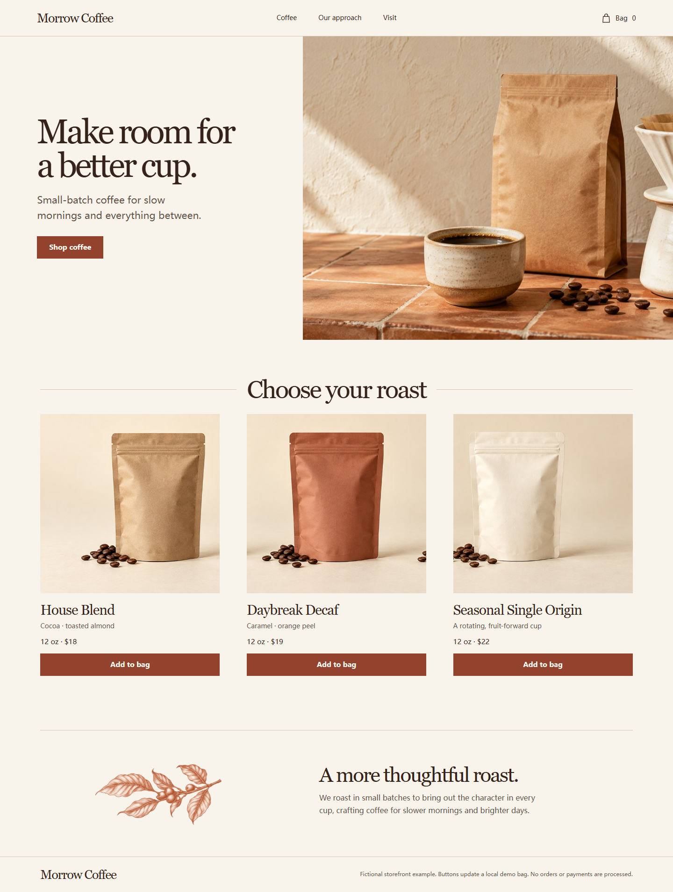
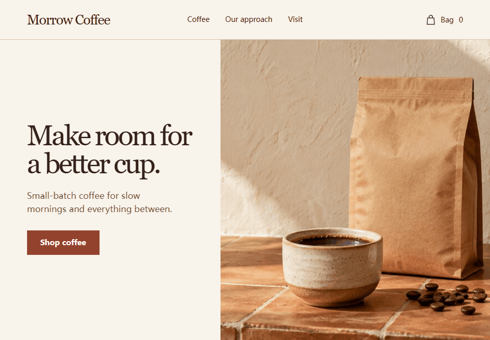
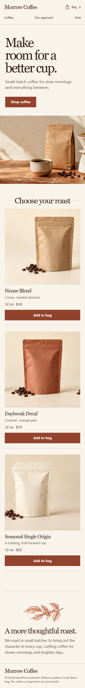
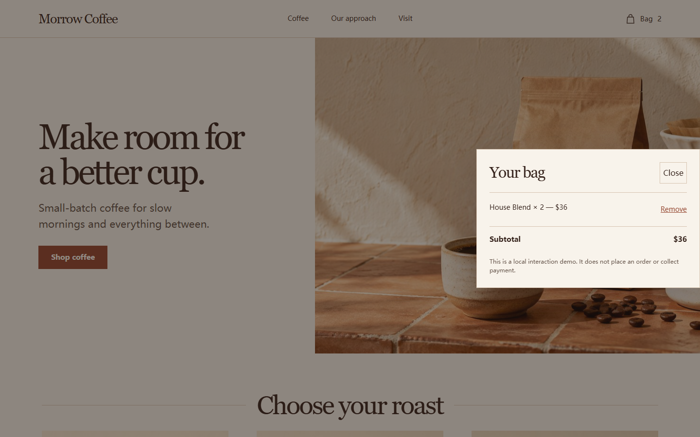

# glasspring

[English](README.md) · [简体中文](README.zh-CN.md)

**Glasspring is a project-local Agent Skill for coding agents working on responsive web interfaces.** It routes each task to relevant bundled design references and offers local checks for selected implementation details.

The package follows the open [Agent Skills format](https://agentskills.io/specification): a `SKILL.md` with supporting references, scripts, and assets. That format does not establish host discovery or behavior. Glasspring has no automated pipeline that turns live-product observations into new reference cards; its browser tools inspect a URL supplied for a specific task or check.

> **Release status: BLOCKED for a stable release.** This is a public source preview. Reference provenance and rights, privacy/history review, an unresolved contrast failure in the historical audit, live host behavior, independent efficacy, and browser dependency integrity still need resolution. See the [release gates](docs/RELEASE-GATES.md).

## What it does

- **New standalone preview:** build a page and deliver <code>tokens.css</code>, <code>preview.html</code>, and <code>design-notes.md</code>.
- **Full restyle:** work in the existing app, preserve its entrypoints, and record before/after evidence.
- **Small UI edit:** keep the existing design system and check the affected area.
- **Review only:** report findings without editing files.

For new previews and restyles, references route by product type, domain or style pack, platform, and stack. A new-preview workflow asks the agent to propose three distinct directions and select one before building; this is an instruction, not evidence of better results. The default design language is Apple-inspired; the brief and existing design system take priority, and glass is optional.

Available checks include selected text-contrast calculations, a heuristic style-pattern scan, an output contract for new previews, and optional browser screenshots and interaction probes. An optional stdio MCP server exposes some checks; registration is manual, and production host integration has not been verified.

The router can select platform-specific references, but the published example and validated output focus on responsive web previews. Native apps, games, and mini-programs receive a web preview unless a separate platform implementation has been built and tested.

## Coffee storefront example

This fictional storefront is a **manual example guided by Glasspring's references and checks**. It was not generated in a live coding-agent host session and is not an efficacy result. The screenshots and GIF show the page and its local bag interaction. Products, copy, and images are fictional; the bag updates page state and subtotal only, with no order or payment service.

 Desktop page at 1440px

 Local shopping-bag interaction

  
View the mobile layout and open-bag state

  

  

Preview the example from the repository root:

~~~sh
python -m http.server 8000 --directory examples/coffee-storefront
~~~

Then open http://127.0.0.1:8000/preview.html. The [example README](examples/coffee-storefront/README.md) and [design notes](examples/coffee-storefront/design-notes.md) describe its setup, decisions, checks, and limits.

## Install and try

Install into a disposable project first. Replace <code>PATH_TO_PROJECT</code> with that project's path.

The audited toolchain used Node.js 22.14 and Python 3.12; these are tested versions, not minimum-version guarantees.

~~~sh
git clone https://github.com/Rethymus/glasspring.git
cd glasspring
node skills/glasspring/scripts/install.mjs --target "PATH_TO_PROJECT" --host codex --dry-run
node skills/glasspring/scripts/install.mjs --target "PATH_TO_PROJECT" --host codex
~~~

For Claude Code, use <code>--host claude</code>. The installer copies the skill into the project's <code>.agents/skills/glasspring</code> or <code>.claude/skills/glasspring</code> directory. File-copy checks do not prove that a host discovers or follows the Skill. See [installation and host verification](INSTALL.md) for evidence, backup/restore, and removal steps.

After installing, try a task like this in a coding-agent session:

~~~text
Use Glasspring to create a responsive storefront for fictional Morrow Coffee. Use warm cream (#f8f3eb), espresso text (#35221b), and terracotta actions (#93432d). Include a hero, three product cards, and a keyboard-operable local bag that adds and removes products and updates the subtotal; do not add checkout or payment. Use only assets already in the target project. If it has no product imagery, create simple CSS or inline SVG illustrations; do not download external assets. Deliver tokens.css, preview.html, and design-notes.md. Check 390px and 1440px layouts, and report checks you cannot run.
~~~

This is an example request, not a recorded Agent run or a recipe for reproducing the manual screenshots above.

## Checks and evidence

Run repository checks from the root:

~~~sh
python -m unittest discover -s tests -v
node skills/glasspring/scripts/install.mjs --selftest
python skills/glasspring/scripts/verify_output.py --selftest
python skills/glasspring/scripts/mcp_server.py --selftest
~~~

These checks exercise repository code, not an Agent design task. The standalone-preview contract and browser checks apply only when their required inputs and tools are available. Browser probes need Chromium; the optional axe check also needs network access. The checks do not score overall design quality, establish a benefit from using the Skill, or certify complete WCAG conformance.

Current host evidence is limited: one fresh Codex session listed Skill metadata, but reading the installed file and task behavior remain **UNKNOWN**; Claude discovery and task behavior are **NOT_RUN**. Independent efficacy is **NOT_RUN**. The stable release remains **BLOCKED**. See [installation evidence](INSTALL.md), [evaluation and research](docs/EVALUATION.md), [release gates](docs/RELEASE-GATES.md), and [security notes](SECURITY.md).

## Project files and safety

- [Installable Skill](skills/glasspring/): entrypoint, routed references, scripts, and templates.
- [Coffee storefront example](examples/coffee-storefront/): a manual example, not benchmark evidence.
- [Architecture](docs/ARCHITECTURE.md), [evaluation](docs/EVALUATION.md), and [release gates](docs/RELEASE-GATES.md): product boundary and evidence.
- [Provenance](PROVENANCE.md), [third-party notices](THIRD_PARTY_NOTICES.md), [contributing](CONTRIBUTING.md), and [security](SECURITY.md).

Tools run with the invoking user's permissions; they are not a sandbox. Browser probes may execute target-page code and the optional axe check retrieves axe-core from a CDN. Run them only against trusted projects and review [SECURITY.md](SECURITY.md).

The repository includes an [MIT license file](LICENSE). Rights review for retained third-party text, code, and assets remains unresolved; the license file does not establish that those materials are cleared. See the [third-party review](THIRD_PARTY_NOTICES.md).
