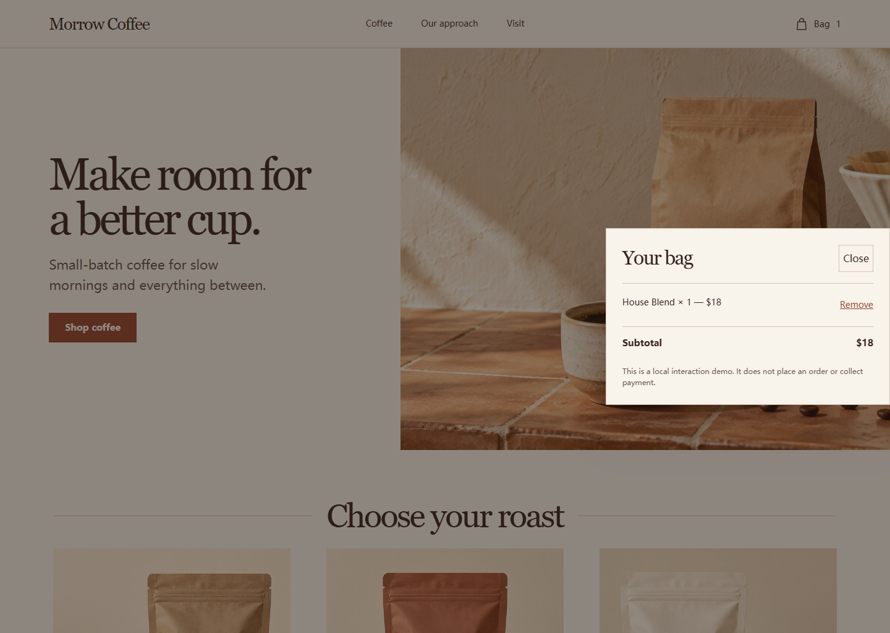

# glasspring

[English](README.md) | [简体中文](README.zh-CN.md)

**面向编码智能体的响应式网页设计与评审工作流 Skill。**

Glasspring 引导智能体完成网页预览、整体重设计、局部修改或设计评审。仓库包含一个 Skill 入口、静态设计参考卡，以及只能提供有限观察结果的本地或浏览器检查。参考卡不会自动采集实时产品；仓库也没有带版本记录的产品采集与研究验证流程。

> **截至 2026-10-25：公开源码预览版；稳定发行状态为 NO-GO。** 宿主中的实际任务表现和独立效果评测尚未验证，隐私审查仅覆盖部分范围，第三方权利仍被阻断。详见[发布门槛](docs/RELEASE-GATES.md)。

## Glasspring 能做什么

| 任务 | 工作流与交付物 |
|---|---|
| 新建预览 | 创建 `tokens.css`、`preview.html` 和 `design-notes.md`。 |
| 整体重设计 | 在现有应用和令牌入口中修改，并提供前后对比证据与设计说明。 |
| 局部修改 | 保留现有系统，只检查改动涉及的范围。 |
| 仅评审 | 报告发现和证据，不修改项目文件。 |

用户 brief 和项目已有的设计系统优先。玻璃效果及其他风格选择均为可选项。原生 App、游戏和小程序需求会生成网页预览，除非对应平台另行实现并测试。

## 咖啡售卖页示例

仓库包含一个受[评测协议](evals/protocol.json)中公开咖啡店试点 brief 启发制作的虚构售卖页示意。该 brief 提到一份品牌配色素材，但仓库未包含这份素材。以下本地 Chromium 截图仅展示示意页面，**不是可复现的评测输入，也不是 Glasspring 智能体运行的产物**，不能证明设计质量提升、宿主发现了 Skill 或任务成功。

手机布局与本地购物袋交互

品牌、商品、文案和价格均为虚构。购物袋只更新页面本地状态，不会下单或收款。在仓库根目录运行：

~~~sh
python -m http.server 8000 --directory examples/coffee-storefront
~~~

然后打开 `http://127.0.0.1:8000/`。页面来源和证据边界见[示例说明](examples/coffee-storefront/README.md)。

## 安装并试用

克隆仓库，并先安装到一次性测试项目：

~~~sh
git clone https://github.com/Rethymus/glasspring.git
cd glasspring
node skills/glasspring/scripts/install.mjs --target "PATH_TO_PROJECT" --host codex
~~~

请将 `PATH_TO_PROJECT` 替换为当前终端可用的路径。安装到 Claude Code 时使用 `--host claude`。安装器只负责复制文件，不能证明宿主会发现或遵循 Skill。请启动一个新的宿主会话，确认列表中出现 Glasspring，再尝试一个小任务。备份、试运行和已观察到的宿主矩阵见[安装说明](INSTALL.md)。

试用任务示例：

> 使用 Glasspring 为值班工程师设计响应式事故仪表盘。保留现有品牌令牌；让严重级别筛选和暂停控制可以工作，并提供有用的加载态和空状态。

可选 MCP 服务器需手动配置宿主。自测覆盖本地 stdio 握手；尚未验证生产环境中的宿主集成。

## 可运行的检查

当前 CI 工作流运行：

~~~sh
python -m unittest discover -s tests -v
node skills/glasspring/scripts/install.mjs --selftest
python skills/glasspring/scripts/verify_output.py --selftest
python skills/glasspring/scripts/mcp_server.py --selftest
~~~

对实际生成目录运行 `python skills/glasspring/scripts/doctor.py --target "PATH_TO_RUN"`，可检查部分静态规则和输出结构。它不能证明设计质量，也不会验证所有交互。

浏览器探针需要 Chromium。`probe_render.py` 使用本地页面 URL，并在可用时从 cdnjs 获取 axe-core 4.10.2。缺少浏览器、axe 或点击观察时，结果会保持为 `UNKNOWN` 或导致相关门禁失败，不会计为 `PASS`。这些探针不能证明完全符合 WCAG。

~~~sh
# 终端 1
python -m http.server 8000 --directory "PATH_TO_RUN"

# 终端 2
python skills/glasspring/scripts/probe_render.py http://127.0.0.1:8000/preview.html
~~~

## 证据与发布状态

| 项目 | 状态与证据 |
|---|---|
| 已发布 main 快照的机械 CI | 截至 2026-10-25，在 Windows、macOS、Ubuntu 上为 `PASS`。见[运行记录](https://github.com/Rethymus/glasspring/actions/runs/40198893762)。该检查未启动编码智能体宿主。 |
| 最近一次有记录的完整样本套件 | `FAIL`：16 行中 12 项 `PASS`、1 项真实对比度 `FAIL`、1 项预期负向对照、2 项依赖网络的 `SKIP`；退出码为 1。样本页面未包含在本仓库中，因此无法重放，状态为 `INSUFFICIENT_EVIDENCE`。 |
| 全新会话中的宿主行为 | `PARTIAL`：一个 Codex 会话列出了 Skill 元数据（`PASS`）；安装文件读取和任务表现为 `UNKNOWN`；Claude Code 的发现与任务表现为 `NOT_RUN`。 |
| 独立效果比较 | `NOT_RUN`：公开 brief 是试点，不是隐藏留出集。另有两个任务引用了缺失输入，因此无法重放，状态为 `INSUFFICIENT_EVIDENCE`。 |
| 项目隐私审查 | `PARTIAL`：初始源码快照的启发式扫描未发现常见密钥模式；示例另行审查。未完成全部二进制文件、Git 历史或专用密钥扫描。 |
| 第三方权利与来源 | `BLOCKED`：逐文件来源、许可证义务和授权资格仍未核清。 |
| 运行时依赖完整性 | `OPEN`：浏览器检查会从公共 CDN 获取 axe-core；校验和与离线策略尚未确定。 |

目前没有证据支持“设计质量提升”“兼容所有智能体”或“完全符合 WCAG”等说法。根目录 MIT 许可证不能清除第三方文字、代码、截图或素材的授权问题。详见[评测说明](docs/EVALUATION.md)、[来源记录](PROVENANCE.md)、[第三方声明](THIRD_PARTY_NOTICES.md)和[安全与隐私](SECURITY.md)。

## 安全与仓库结构

工具以当前宿主用户的文件和进程权限运行；Skill 中的范围说明不是沙箱。浏览器探针会执行被检查页面的代码，MCP 路径参数也没有限制在指定工作区中。使用前请阅读[安全与隐私说明](SECURITY.md)。

| 路径 | 用途 |
|---|---|
| `skills/glasspring/SKILL.md` | 主工作流和参考路由 |
| `skills/glasspring/references/` | 静态设计指导：领域、风格、平台、类型和令牌 |
| `skills/glasspring/scripts/` | 安装器、定向检查、截图和浏览器探针 |
| `skills/glasspring/assets/` | 说明模板、评审量表和视觉参考 |
| `examples/coffee-storefront/` | 虚构的本地咖啡售卖页及截图 |
| `tests/` | 针对部分失败边界的自动回归检查 |
| `evals/protocol.json` | 尚未执行的试点评估协议 |
| `docs/` | 架构、评测和发布证据 |

## 许可证

请查看 [LICENSE](LICENSE) 和[第三方声明](THIRD_PARTY_NOTICES.md)。MIT 许可证只适用于贡献者有权授权的内容。
